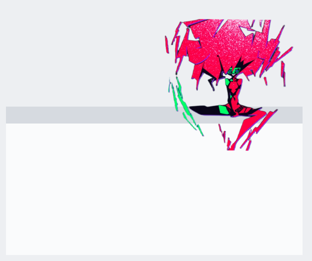
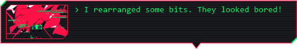

<p align="center">
  
  
</p>

# Capri

A small desktop companion for Windows: Capri, from *Cyberpunk: Edgerunners*, lives on your screen. She sits there, stretches, yawns, falls asleep, peeks in from the edge, sits on your windows, gets head pats, and plays tricks on your screen. If you connect an AI model she also talks to you, and can look at your screen when you ask.

Beware that Capri may try to take over your human CPU. No responsibility is taken for her actions.

By default everything runs locally. There is no account and no telemetry, and the only thing she talks to is a model server on your own machine. You can optionally connect a cloud model with your own API key (see below); that is off until you switch it on.

<p align="center">
  
  
</p>
<p align="center">
  
</p>

## Download

The latest release is **V2**. Get `Capri-Setup.exe` from the [Releases](../../releases) page and run it. Windows may show a SmartScreen warning because the file is not code-signed; the source is all here, and you can build it yourself (below).

## What she does

Most of Capri works with **no AI at all**: no model, no internet, nothing extra to install. The AI is only for open-ended conversation and for looking at your screen, and all of it is optional. Anything that needs a model falls back to her built-in lines, or tells you a model is needed.

### Works without any AI

**Alive on your desktop**
- Idle reactions: stretching, looking around, yawning, falling asleep, peeking from the screen edge. Each can be switched off.
- Head pats: hover over her, or click.
- She sits on the top edge of your windows and follows them when they move. Drop her on one to seat her.
- Steps aside while a full-screen game or video is in front, and comes back after.
- A tray menu for everything, in a black, crimson and green terminal style. **Start with Windows** is in it (off until you tick it).

**Mischief** (off by default; Ctrl+Alt+C stops it at once)
- Screen glitches in six styles: bars, tear, corruption, hex rain, a fake "ENGRAM SYNC" progress box, and a red cursor that chases yours. All of them are painted on a click-through overlay and stay gentle: low contrast, nothing flashes, and reduced motion in Windows turns them off.
- "You've been hacked" notes.

**She notices and dares** (no screen capture)
- She remarks, rarely, when you come back after a long break, stay up late, run low on battery, max out the CPU, or sit in one program for hours. She reads only the clock, idle time, CPU, battery and the name of the program in front.
- Dares: after about ten minutes in one program she may dare you with something quick and harmless for it ("Dare you to close every tab except one."). Say "dare me" any time, and "done" when you have. Without a model they come from her own list.
- **Sync:** a 0 to 100% meter of how far she has got into your life. It grows with time, chatting, pats, agreeing with her and finished dares (with daily limits), opens up new glitch styles, and is shown in her sync glitch box. Ask "how's our sync?".

**Errands** (typed or spoken, matched from plain words, no model needed)
- Timers, alarms and reminders: "set a timer for 10 minutes", "wake me at 7am", "remind me in 20 minutes to stretch", and a study timer. A finished timer interrupts whatever she was saying.
- "Open downloads", "open Discord", "open Edge": a short fixed list of folders and Windows tools, plus any program with a Start menu shortcut, found by name. "Open youtube", "open github" and a few sites open in your browser.
- "Pause the music", "skip", "previous song", "mute", "turn it up".
- "Search for cute cats on YouTube", "google X": opens your browser's results.
- **"Play X on Spotify":** she opens Spotify's search, finds the Play button for that song by name (through the same accessibility interface screen readers use, so it works in any language) and presses it, then checks that something new is really playing. If she can't find it, she writes `%LocalAppData%\Capri\spotify-buttons.txt` with what she saw.
- **"Play X on YouTube":** makes one request to youtube.com to find the first video, then opens it in your browser.
- Speaking these needs speech recognition (below), but not a chat model.

**What she remembers and says herself**
- "Remember that my dog is called Bo." Notes live in a plain text file (`%LocalAppData%\Capri\memory.txt`) that you can read or delete. She refuses passwords. "Forget about my dog", "forget everything" and the Chat, Memory menu manage it. The notes are kept without a model; she only brings them up in conversation when a model is on.
- Her real lines from the show for questions that have one ("who are you", "what are you", "are you an AI", and a few more).
- She shows what music or video is playing, with a short canned cheer.

### Needs an AI model

Local with [Ollama](https://ollama.com) or LM Studio, or optionally a cloud model with your own key (see below).

- **Chat:** a window in her style (Ctrl+Alt+T), or just talk: click the mic beside her, or press Ctrl+Alt+V, and she answers in a speech bubble.
- **Look:** press Ctrl+Alt+L or ask "what am I looking at?" or "what should I buy here?". She takes one screenshot, sends it to your vision model, and throws it away. It is only taken when you ask, held in memory only, and never written to disk. You can switch it off in Chat, "Let her look when I ask".
- **Dares about your screen** (off by default, and it asks first): one screenshot when she dares you, so the dare fits what is really on screen (a game, a page). It goes only to your local model, and to a cloud model only if you allowed screenshots there. She stays hidden in fullscreen games unless you switch off Hide in fullscreen.
- Dares and music comments written fresh by the model instead of from her list, using her notes about you when memory is on.
- Her tone changing with how far sync has got.

## Hotkeys

| Keys | What it does |
| --- | --- |
| Ctrl+Alt+C | Hop off the cursor, and stop any glitch |
| Ctrl+Alt+T | Open the chat window |
| Ctrl+Alt+V | Talk to her (click again to stop, or press DONE to send early) |
| Ctrl+Alt+L | Look at my screen |

## Setting up her brain

Chat, voice and Look use a model server on your own computer. [Ollama](https://ollama.com) is the easiest.

1. Install Ollama and pull a model. A vision-capable one (for example `qwen3.5:9b`) also lets her look at your screen. A text-only model works for chat.
2. In her tray menu choose Chat, then Use a local model. She finds Ollama or LM Studio on the usual local ports. Only `localhost` and loopback addresses are accepted.
3. Optional: put a `persona.txt` in `%LocalAppData%\Capri` to change how she talks.

### Cloud models (optional)

No GPU? Chat, Cloud model settings lets you use OpenRouter, OpenAI, Anthropic, or any OpenAI-style https address with **your own API key**. A Claude or ChatGPT subscription is not an API key; keys come from the provider's developer console and are billed separately (her replies are short, so a small model costs very little).

- Providers show a key only once, when you create it. Copy it then; if you lose it, make a new one. Free models on OpenRouter work with a $0 key. Some models think before answering and may feel slow or sometimes answer with nothing; she retries once and tells you.
- It is off until you switch it on. Your chat messages and her persona are sent to that company.
- Screenshots (Look) and her notes about you are **not** sent unless you tick their own boxes in the dialog. Without that box, Look still works if you also run a local vision model.
- The key is stored encrypted for your Windows account only (`%LocalAppData%\Capri\cloud.key`), never in the settings file.
- Only https addresses are accepted for the cloud.

### Better ears (optional)

Install [whisper.cpp](https://github.com/ggml-org/whisper.cpp) and put it here:

```
%LocalAppData%\Capri\speech\bin\Release\whisper-cli.exe
%LocalAppData%\Capri\speech\models\ggml-small.en.bin
```

She uses it automatically when it is there (Chat menu shows which ears are active). `base.en` is faster and less accurate.

### Voice lines (optional)

Nothing is bundled. Put `.wav` clips in `%LocalAppData%\Capri\voices` named for an occasion (`pat.wav`, `hello-2.wav`, ...). A `README.txt` is written into that folder with the full list of names.

## Build it yourself

Windows with the .NET Framework 4 (already part of Windows 10 and 11). No other tools or packages.

```
build.bat
```

This builds `build\Capri.exe`, then `build\Capri-Setup.exe`, which contains `Capri.exe`. Quit Capri first if she is running from the build folder.

The art is embedded from `assets\art`. `tools\make-art.ps1` rebuilds those trimmed sprites from full-size frames, which are not kept in this repository (put them in `assets\originals` if you have them).

Her smoke test is built in: `Capri.exe --smoke-test <folder>` runs the checks and saves screenshots to the folder.

## Disclaimer

This is an unofficial fan project, not affiliated with or endorsed by CD PROJEKT RED or Studio Trigger, and it is not for sale. Capri, Chip, and all artwork and sprites used here belong to CD PROJEKT RED and Studio Trigger (*Cyberpunk: Edgerunners*). If you are a rights holder and want something changed or removed, open an issue and it will be dealt with.

## Credits

- Started from [lachydotmcg/capri-desktop](https://github.com/lachydotmcg/capri-desktop), which brought Capri to the desktop first. Inspired by jpartnma_'s TikTok video. Based on lachydotmcg's 0.2.0 release.
- Code added since then is under the [MIT license](LICENSE); the original code remains under its author's terms.
